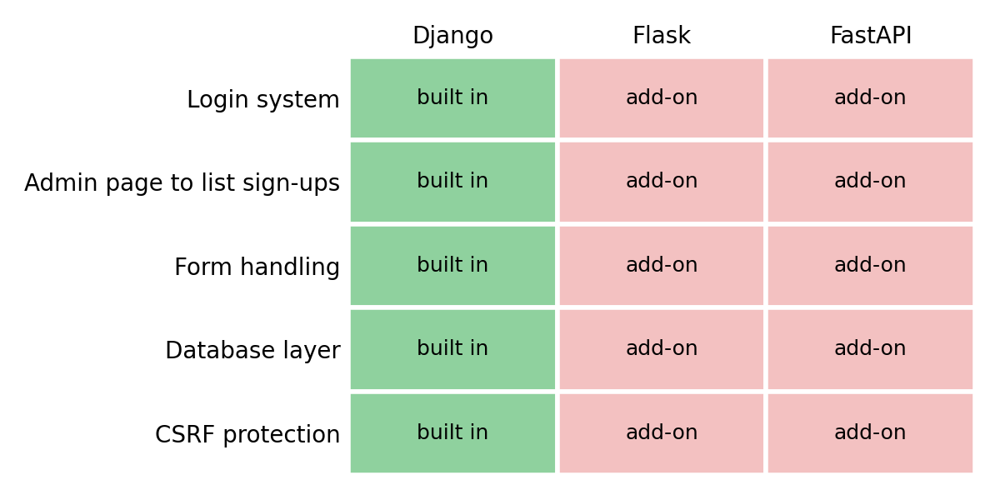

# Context

Our sleep and study habits project needs a simple recruitment website. Right now,
interested students email the lab and a grad student manually sends back eligibility
questions. That takes hours each week and people drop out along the way.

The site needs to:

1. Describe the study briefly.
2. Run an **eligibility screener** of about eight questions.
3. Collect a name and email from people who qualify.
4. Let research assistants (RAs) log in and see the list of sign-ups.

The constraints that matter most:

- The grad student knows Python for data analysis but has **never built a website**.
- The site stores contact info, so **security and privacy** matter and campus IT will ask how data is stored.
- It should be running in about **a month**.
- It may be **reused for future studies**, but nobody will maintain it full time.

**The decision:** should we build this with Django or Flask (both Python)? I also
looked at FastAPI because I have used it before.

::: {.callout-note}
## Quick definitions
**Django** is "batteries included": login, database, forms, and an admin page come
with it. **Flask** is a "micro" framework: it gives you the basics and you pick
add-ons for everything else. **FastAPI** is a newer framework built mainly for APIs.
:::

# SWOT: Django

## Strengths

- **Login and admin are built in.** The RA sign-up list is basically Django's free admin page, with almost no code.
- **Security defaults are on.** Django protects against CSRF, SQL injection, and XSS by default and hashes passwords [@django_docs]. That helps a first-time web developer a lot.
- **One standard way to do things**, so docs and tutorials all match.
- **Built-in forms** make the eight-question screener easy to validate.

## Weaknesses

- **Steeper learning curve.** Models, views, templates, URLs, and settings are a lot for someone who has only done data analysis.
- **Heavy for a small site.** Many files and structure for about four pages.
- Some "magic" that is hard to debug when you don't know what it is doing.

## Opportunities

- **Easy to reuse for later studies.** A new study could be a new model in the same project.
- The admin page can filter sign-ups, so RAs may not need a custom dashboard.
- Python data skills carry over (the Django ORM feels like working with a table).

## Threats

- **Upgrades:** Django releases regularly, so an unmaintained site can fall behind on security patches.
- **Hosting:** campus IT may need to support a full Django deployment (server, database, settings), which could delay the one-month goal.
- If the grad student leaves, the next person has to learn Django too.

# SWOT: Flask

## Strengths

- **Easy to start.** A working page is about five lines of Python, which is friendly to a beginner.
- **Small and readable.** The whole site could fit in a few files the grad student can understand.
- **Flexible.** The screener logic can be plain Python, which the grad student already knows.

## Weaknesses

- **Security is your job.** Flask has no built-in login or CSRF protection, and you add extensions like Flask-Login and Flask-WTF [@flask_docs].
- **Many small choices** (which database library? which login extension?) with no single "right" answer.
- The RA sign-up list has to be **built by hand**.

## Opportunities

- A quick prototype could be shown to the PI within the first week or two.
- Could grow gradually if the lab only needs small features.

## Threats

- **A missed or wrong add-on setup could leak contact info.** One forgotten protection is a privacy problem, and campus IT will care.
- Add-ons are maintained by different people and can go stale.
- With no standard layout, a future maintainer may not understand how the site was put together.

# Another Option: FastAPI

I have used FastAPI before and it is quite easy to write [@fastapi_docs]. It is great
for APIs, has clear error messages, and makes automatic docs. But for *this* project
it has the same problem as Flask, and a bit more:

- No built-in login, sessions, or admin page, so everything RAs need is built by hand.
- It is designed for APIs that send data (JSON), not pages with forms, so HTML pages need extra setup.
- Same security risk as Flask: protections must be added by us.

FastAPI is a good choice **if** we later want a separate API (for example, the screener feeding a data pipeline). It is not the best fit for a first website with logins.

# Another Option: No-Code (Form + Simple Page)

Another idea is to skip custom code. A university-approved form tool (Microsoft Forms,
Qualtrics, or REDCap) could run the screener and sign-up, and a simple UW-hosted or
SharePoint page could describe the study.

- **Pros:** live in days, no server to maintain, and IT may have already approved where the data is stored. RAs can read responses in the form's spreadsheet output.
- **Cons:** limited screener logic and design, harder to reuse as a "real" site, and the RA list depends on who is shared on the form.
- **Caution:** commercial site builders like Webflow store data on a third-party server IT has not reviewed, so I would keep participant data in the university form tool.

This may be the *fastest and safest* option. I kept Django as my main recommendation
because the assignment asks for a framework choice, but this is worth raising with IT.

# Comparison

@fig-features shows which things the project needs ship with each framework, and
@tbl-summary sums up the main differences.

{#fig-features}

| Question | Django | Flask | FastAPI |
|---|---|---|---|
| Learning curve for a beginner | Steeper | Gentle | Gentle |
| RA login + sign-up list | Mostly built in | Build it yourself | Build it yourself |
| Security by default | Strong | Add-ons needed | Add-ons needed |
| Fits a small one-time site | OK | Great | OK |
| Easy to reuse and hand off | Great | Depends | Depends |

: Summary comparison for the sleep study site {#tbl-summary}

# Recommendation

**I recommend Django.** The biggest risks for this project are not build speed. They
are **security of contact information** and **handing it off** to people who won't
maintain it full time. Django has login, an admin page for RAs, form validation, and
security protections built in, which covers most of the requirements and the questions
campus IT will ask. Flask is easier to start, but each missing piece (login, CSRF,
sign-up list) is something we must choose, set up, and get right. FastAPI is easiest
for me personally, but it fits APIs better than a logged-in website.

The learning curve is the real cost of Django, so the grad student should start with the
official tutorial and use the admin page for the RA view instead of building a custom
one. If IT can only host something very simple, Flask would be the fallback.

## Assumptions and questions for IT

1. **No-code:** I assumed a custom site is wanted. *Would a university-approved form plus a simple page be acceptable instead?*
2. **Hosting:** I assumed the university can host a Python app with a database. *Is that true, and where would it live?*
3. **Data storage:** I assumed a standard database (SQLite for a small study, or PostgreSQL). *Does IT require a specific one, or encryption at rest?*
4. **Maintenance:** I assumed no one is assigned long term. *Who will apply security updates after the study starts?*
5. **Ethics:** I assumed screener answers (sleep and health info) are stored only for people who qualify. *Does the IRB need to approve this?*
6. **Timeline:** I assumed about a month is enough for a grad student with no web experience. *Can someone with web experience help in the first week?*

# Python Sketch

A Django model for a sign-up is only a few lines, which shows why the admin page comes cheap.[^1]

```python
from django.db import models

class SignUp(models.Model):
    name = models.CharField(max_length=100)
    email = models.EmailField()
    created = models.DateTimeField(auto_now_add=True)
```

For more, see the [Django tutorial](https://docs.djangoproject.com/en/stable/intro/tutorial01/).

[^1]: This is a sketch, not tested code. It would need to be registered in `admin.py` to show up in the admin page.
